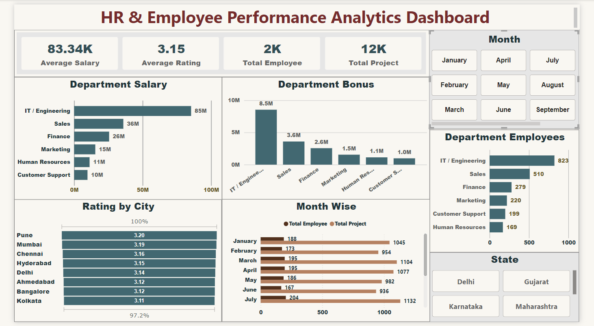

# 👥 HR & Employee Performance Analytics Dashboard

An end-to-end data analytics project designed to track, analyze, and optimize human resource metrics and employee performance benchmarks. This project demonstrates a complete data production pipeline: managing raw records in **Excel**, automated data cleansing via **Python**, structural database management using **SQL**, and crafting a highly interactive executive dashboard in **Power BI**.

---

## 📸 Dashboard Preview


---

## 🔗 Live Interactive Dashboard

👉 **[Click Here to View the Live Production Dashboard]()**  
*(This link provides full interactive access to filters, carrier segmentations, and dynamic business metrics live on Looker Studio).*

---

## 🚀 Key Features & Business Visuals
* **Executive HR KPIs:** Instant visibility into core workforce metrics: **Average Salary (83.34K)**, **Average Performance Rating (3.15)**, **Total Employees (2K)**, and **Total Projects Completed (12K)**.
* **Financial Workforce Operations:** In-depth departmental breakdown analyzing overall **Salaries** and **Bonuses** distributed to identify high-cost resource centers.
* **Demographic Metrics:** Spatial tracking of top corporate talent distributed across major **Cities** and **States** using offline-compatible visuals.
* **Workforce Retention & Hiring Trends:** A comprehensive **Month-Wise Recruitment** trend timeline mapping combined cycles for employee onboarding and overall project output.
* **Interactive Slicers:** Dynamic filtering capabilities engineered for **Month** and **State** to allow multi-dimensional data drilling.

---

## 🛠️ Tech Stack & Workflow Architecture
1. **Excel:** Raw historical employee dataset schema verification and storage.
2. **Python (Pandas & SQLAlchemy):** Automated data profiling, handled missing/null values, resolved schema types, performed feature engineering (automated Bonus calculations), and managed secure connection injection directly into SQL.
3. **SQL (MySQL):** Created and optimized relational database infrastructure to execute business logic queries (e.g., Department headcount distributions, Top earners).
4. **Power BI Desktop:** Implemented data modeling, established robust matrix parameters, and engineered a modern corporate UI/UX reporting structure.

---

## 🔢 Core DAX Measures Used

### 1. Total Employees
```dax
Total Employee = COUNT(hr_employee_data[EmployeeID])
```

### 2. Average Salary
```dax
Average Salary = AVERAGE(hr_employee_data[Salary])
```

### 3. Total Projects Completed
```dax
Total Project = SUM(hr_employee_data[ProjectsCompleted])
```

---

## 📈 Major Business Insights Derived
1. **Resource Allocation:** The **IT / Engineering** department consumes the highest financial resource, accounting for the largest share of overall company Salary (~85M) and Bonuses (~8.5M).
2. **Geographical Talent Hubs:** Core workforce density is heavily concentrated within major metro locations, led dynamically by **Delhi** and **Mumbai**.
3. **Performance Benchmarks:** The organization maintains a highly stable and competitive talent quality index with an overall average performance rating of **3.15/5**.

---

## 🤝 Contact & Connect
If you have any questions about this project or would like to collaborate on data analytics initiatives, feel free to reach out!

- **👤 Name:** Manpreet Singh
- **📧 Gmail:** preetaulakh8756@gmail.com
- **🖥️ GitHub Profile:** [Preet-Aulakh](https://github.com)
